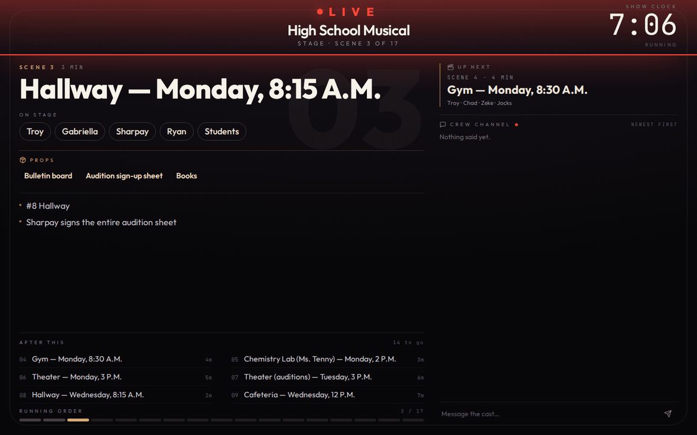
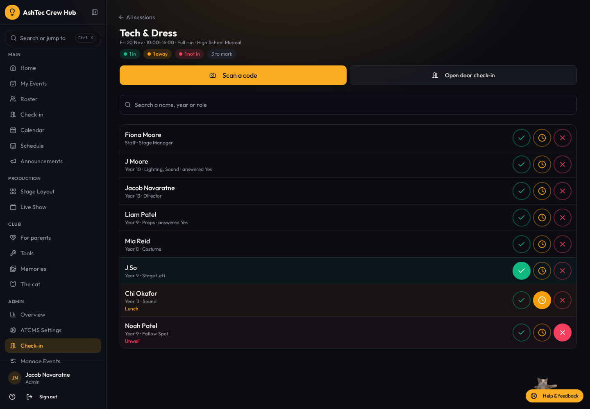
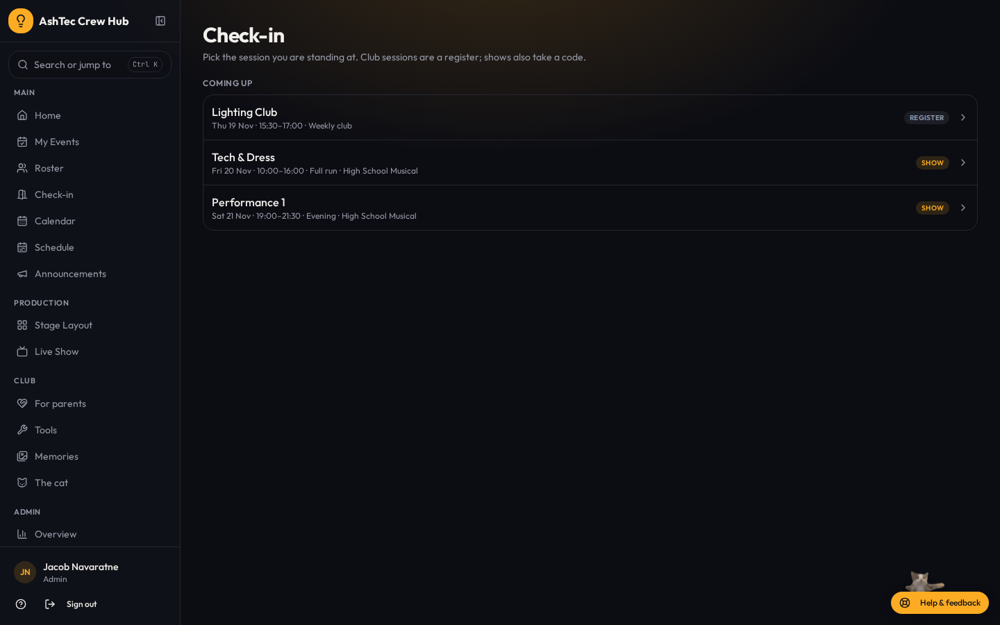
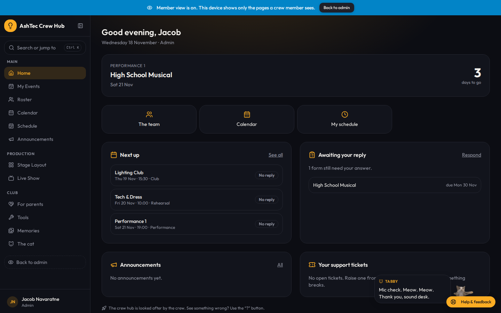
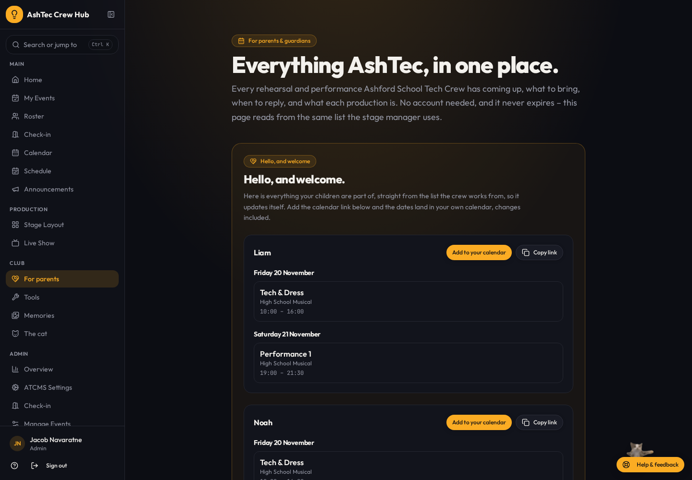
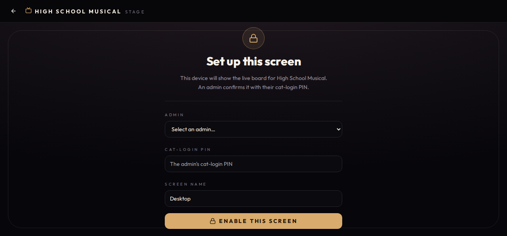

<p align="center">
  
</p>

<h1 align="center">AshTec Crew Hub</h1>
<h3 align="center">Shows, calls, attendance and check-in for a school drama and tech crew</h3>

<p align="center">
  <a href="https://ashtec.dino.icu/"></a>
  
  
  
  
</p>

> **This app was built with AI.** The code, the schema, the copy and this README
> were written with [gorkie](https://github.com/techwithanirudh/gorkie) and
> OpenCode, with Jacob directing, testing every flow and deciding what ships.
> It is real software running a real crew, so read the code before you trust it
> with anything that matters.

> **Not official.** AshTec Crew Hub is a student project. It is not affiliated
> with, endorsed by or connected to the school, its trust or any exam board.



---

## What it is

AshTec is the drama and technical crew for school productions. This is the one
place they use instead of a group chat, a spreadsheet and a paper register.

Crew sign in with a school email address (a link in their inbox, no passwords),
see when they are called, answer whether they can make it, sign in and out of the
venue, and read what the show needs from them. Admins build the show, take the
register, run check-in on the door and run the backstage screens during a
performance. Parents get a read-only list of their own child's dates.

It is fully self-hosted on a small box: React and Vite on the front, Express and
PostgreSQL behind it, our own SMTP for email, no external platform at runtime.
Express serves the built SPA itself, so there is one origin, one port, and no
CORS or `SameSite=None` cookie handling.

| | |
| --- | --- |
| **Live** | https://ashtec.dino.icu/ |
| **Repository** | https://github.com/JacobN-OpenCode/AshTecCrewHub |
| **API port** | `1502` (Express). Vite dev runs on `8080` and proxies `/api` to it |
| **Stack** | React 18 + Vite + TypeScript, Express 4, PostgreSQL |

---

## Features

- **Sign in with a link, not a password.** Admin, staff, crew, contractor and
  preview accounts. An address that is not on the crew list is refused with a
  plain message telling the person to ask an admin to add them.
- **Shows and events.** A show holds its rehearsals, performances and club
  sessions. Each dated event has a call time, start and end, what to bring, and
  which show it belongs to.
- **Availability.** Crew answer Yes, Maybe or No per show, with a reason. The
  answer is what the register expects, so nobody has to remember a message.
- **Attendance you can see.** Who was expected, who came, who did not, who was
  away and why. Every admin entry records that an admin made it.
- **One page to take the register.** Pick the session you are standing at, then
  tap a colour per name: green in, yellow away, red not in. Yellow and red ask
  for a reason from a short list, and that reason is stored with the register.
- **Venue check-in by QR.** A crew member shows a code on their phone, an admin
  scans it, and the sign in or out is approved at the door. Shows use the
  scanner; club sessions are a register only.
- **Backstage screens.** A display for the side of the stage showing the current
  scene, who is on it, the props and notes, what is after this, the next scene, a
  show clock and a crew channel. An admin can unlock the controls from a second
  admin's cat-login PIN.
- **Crew chat on the screens.** A message typed on a display is signed with that
  display's name, so the board says which screen is talking.
- **Parents feed.** A parent types their email on `/parents` and sees their own
  child's dates plus a private calendar link. Two siblings on one email each get
  their own list. Nothing is emailed to them and nothing else is revealed.
- **Calendars.** Per member, per parent and per show `.ics` feeds that work in
  Apple Calendar, Google Calendar and anything else that reads a URL.
- **Support tickets.** Crew report a bug or ask for a feature from inside the app.
  A ticket carries the page it came from, the thread, internal notes, who is
  assigned, and one button to remind the maintainers.
- **Admin tools.** Manage events, crew and roles, the email log, feedback forms,
  live show setup, server diagnostics and site settings in one hub.
- **A member view.** One button hides every admin page on that device, for when
  you are standing at the side of a stage and cannot afford a mis-tap.
- **Works on a phone.** Crew pages and admin pages are built for a 390px screen
  first, because that is what people are actually holding.

---

## A look at it

| Taking the register | Picking a session |
| --- | --- |
|  |  |

| Member view | Parents feed |
| --- | --- |
|  |  |

| Setting up a backstage screen |
| --- |
|  |

---

## Requirements

- Node.js 20 or newer (developed on 26.x)
- PostgreSQL 13 or newer. `gen_random_uuid()` is used, so it must be available,
  which it is from PostgreSQL 13 or with `pgcrypto` on older versions.

## Installation

```bash
git clone https://github.com/JacobN-OpenCode/AshTecCrewHub.git
cd AshTecCrewHub
npm ci
cp .env.example .env        # then fill in DATABASE_URL
npm run schema              # applies server/db/schema.sql, safe to re-run
npm run dev                 # Vite on :8080, Express on :1502
```

If you are importing an existing crew from CSV exports instead, `npm run migrate`
creates the schema and imports the rows, upserting on natural keys, so a half
finished import can be repaired by running it again. See
[MIGRATION.md](./MIGRATION.md) for the field mapping and verification queries.

### Environment

See `.env.example` for the annotated list. The ones that matter:

| Variable | Notes |
| --- | --- |
| `DATABASE_URL` | Required |
| `APP_URL` | Public base URL, no trailing slash. Used for magic links and email buttons |
| `PORT` | Defaults to `1502` |
| `SMTP_*` | Optional in development, **required in production** |

With `SMTP_HOST` unset, email is written to the server log instead of sent and
the sign-in URL is printed there. That is deliberate so the app is usable
offline, but it means **sign-in links never arrive in production unless SMTP is
configured.** Never commit `.env`.

### Production build

```bash
npm run build      # production bundle into dist/
npm start          # Express serves dist/ and the API on PORT
```

Any unknown path falls through to `index.html`, so client-side routes deep-link
correctly. `npm start` serves the existing `dist/` and never rebuilds it, so a
frontend change needs `npm run build` before a restart.

### Deploying an update

```bash
cd ~/ashtec-crew-hub
git fetch origin main && git merge origin/main
npm run schema            # only needed when the schema changed, harmless otherwise
npm run build
systemctl restart ashtec-crew-hub
```

Then check `GET /healthz`, which reports the number of endpoints the running
process actually loaded, so you can see which version is live.

A first deployment on a fresh box:

1. Provision PostgreSQL and create the database.
2. `npm ci && npm run build`
3. Put the environment in the service unit or an environment file with
   restrictive permissions.
4. `npm run schema` (or `npm run migrate` when importing CSVs).
5. Copy the built assets into the web root if you serve them separately
   (`cp -r dist/* /var/www/html/`), which is a real copy, not a symlink.
6. Run `npm start` under a supervisor such as systemd, bound to `1502`.
7. Terminate TLS in front of it and proxy to `127.0.0.1:1502`.

---

## Scripts

| Script | What it does |
| --- | --- |
| `npm run dev` | Express with `tsx watch` plus Vite, in parallel |
| `npm run dev:web` | Vite only |
| `npm run dev:server` | Express only |
| `npm run build` | Production frontend build into `dist/` |
| `npm start` | Serve `dist/` and the API on `PORT` |
| `npm run typecheck` | `tsc --noEmit` for the app and the server projects |
| `npm run gen:api` | Regenerates `src/lib/api.ts` from the endpoint modules |
| `npm run schema` | Applies `server/db/schema.sql`, idempotently |
| `npm run migrate` | Creates the schema and imports the CSV exports |
| `npm run seed:hsm` | Fills a High School Musical workspace for a demo |
| `npm run smoke` | End-to-end check against a running server |

## Verifying a deployment

```bash
npm run typecheck
npm run smoke
```

`npm run smoke` is the check that matters. It drives the same `/api/<name>`
endpoints the browser calls, over HTTP, with a real session cookie obtained from
a real magic link, and deliberately imports no endpoint module, so it exercises
the router, auth and database wiring rather than just the business logic. It
covers every QR state (`invalid`, `closed`, `ready`, `not_admin`), roster
authorisation and the write paths including both upserts. It cleans up after
itself and asserts the row counts are unchanged, so it is safe to run repeatedly
against a live database. Point it elsewhere with
`BASE_URL=https://... npm run smoke`.

---

## How it fits together

| Path | What it is |
| --- | --- |
| `src/` | React app. Talks to the API through `src/lib/api.ts` |
| `src/api/` | One file per endpoint, shared by the server and the generated client |
| `src/pages/` | The app. `admin/` is the admin half, `live/` is the backstage board |
| `server/` | Express, auth, email, scheduling, PostgreSQL access |
| `server/db/schema.sql` | Schema, indexes and constraints, all idempotent |
| `packages/` | Shared UI kit: the shadcn-style components the pages use |
| `scripts/` | CSV importer, API client generator, schema runner, smoke test |

### The API client is generated

`src/lib/api.ts` is generated from the endpoint modules:

```bash
npm run gen:api
```

Run it after adding, renaming or removing an endpoint. Editing the file by hand
will be overwritten.

### Aliases

`#api`, `#db`, `#backend`, `#email` and `#auth` are resolved by both Vite and
`tsconfig.json`. Endpoints import `#db` and `#backend`; the browser only ever
imports `#api` and `#auth`, which keeps `pg` and the server-only modules out of
the client bundle. Importing a server module from a page breaks the production
build, so keep shared browser helpers free of server imports.

### Authentication

Single-use magic-link tokens (15 minutes) exchange for a database-backed session
(30 days) held in an `HttpOnly`, `SameSite=Lax` `crew_session` cookie. Sessions
are revoked server-side on sign-out and swept when they expire. Admins can sign
in as a member for support, which sets a second cookie, announces who they are in
a bar across the top, and leaves a "Leave" button to drop back to their own
account.

### Permissions

Server code and pages use the same ideas: `isAdmin`, `isStaff`, `isMaintainer`,
`isContractor` and `isPreviewAccount` are separate flags, because one person can
be several of them at once. `src/lib/permissions.ts` holds the per-permission
mapping used where finer control is needed.

### Scheduled work

`supportEscalate` runs hourly in `Europe/London`. It is the only scheduled
endpoint. The browser never triggers it, and it receives `context.user === null`
because there is no signed-in member.

---

## The MCP server

The crew hub serves its own small [MCP](https://modelcontextprotocol.io) server at `POST /mcp`, so an MCP client (Claude, Cursor, whatever you use) can read the club and post to the live show chat without a browser.

It is off until you give it a token:

```bash
# in .env, on the server
MCP_TOKEN=$(openssl rand -hex 32)   # long and random: it is a password
MCP_EMAIL=you@ashpupil.co.uk        # which admin the tools run as (empty = first admin)
```

Then point a client at it:

```json
{
  "mcpServers": {
    "ashtec-crew-hub": {
      "type": "http",
      "url": "https://ashtec.dino.icu/mcp",
      "headers": { "Authorization": "Bearer <the token you generated>" }
    }
  }
}
```

Tools it exposes: `crew_hub_overview`, `list_sessions`, `get_register`, `list_tickets`, `find_member`, `live_show`, `send_live_show_chat`, `clear_live_show_chat`.

**What keeps it honest.** Without `MCP_TOKEN` the route answers `503`; a wrong token gets `401` (compared in constant time, so a guess gets no hint). No tool can call an arbitrary endpoint, there is no way to create or delete people, change settings or send email, replies stay under 16 kB, and every call is rate limited and logged. Tools run as one named admin, so anything they read is something that admin could already read.

## Data and privacy

An account holds a crew member's name, school year, roles, school email, and
optionally a parent email, contact sharing preference and avatar. Attendance,
availability, venue presence, show responses and support tickets are kept against
that account. The parent email is never mailed: it only unlocks a read-only list
for whoever types it on `/parents`, which is spelled out in `/privacy` in the app.

Crew can clear their parent email, change their avatar and choose what they share
from their profile. Admins can remove a member entirely. Ask an admin or open a
ticket in the app for anything else.

---

## Known limitations

- Sign-in needs working SMTP. Without it only the log gets the link.
- Check-in is built for one person on the door at a time. Two admins can take the
  register at once, and the later tap wins.
- Backstage screens depend on the browser staying open on the display. They are
  not a kiosk app, so someone can still navigate away.
- The member view is a convenience on that device, not a permission. Nothing it
  hides is enforced server side, and `/admin` can still be reached directly.
- Live show controls need an admin PIN per unlock by design, so nobody drops the
  house lights as a joke.

---

## Credits

Built by Jacob ([@SmartSparkCoding](https://github.com/SmartSparkCoding)), tested
screen by screen with the AshTec committee, and written almost entirely by AI
agents under their direction. Icons from [Lucide](https://lucide.dev), UI
primitives from [shadcn/ui](https://ui.shadcn.com). The cat is ours.

## Licence

Source is public for the crew, their families and anyone who wants to run
something similar. No warranty. Ask before deploying it for another school.
